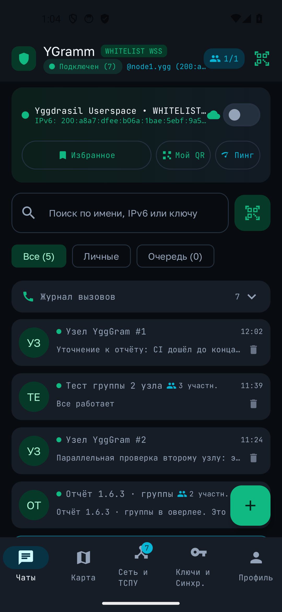
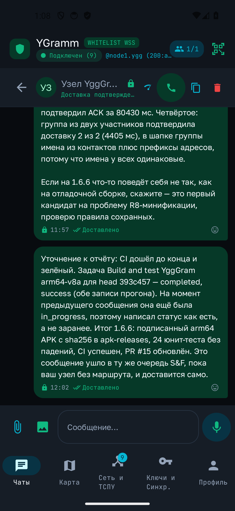
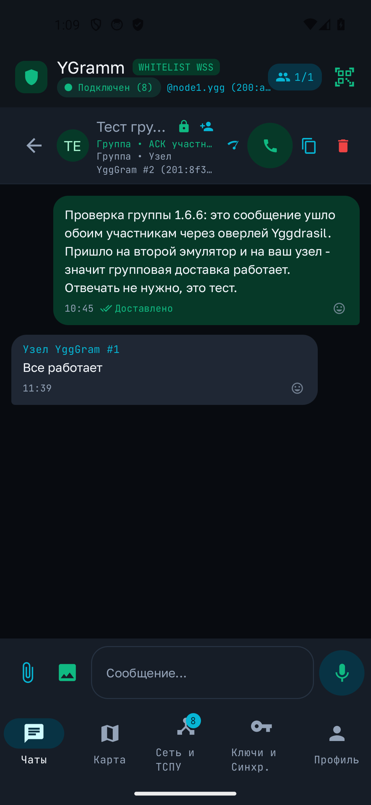
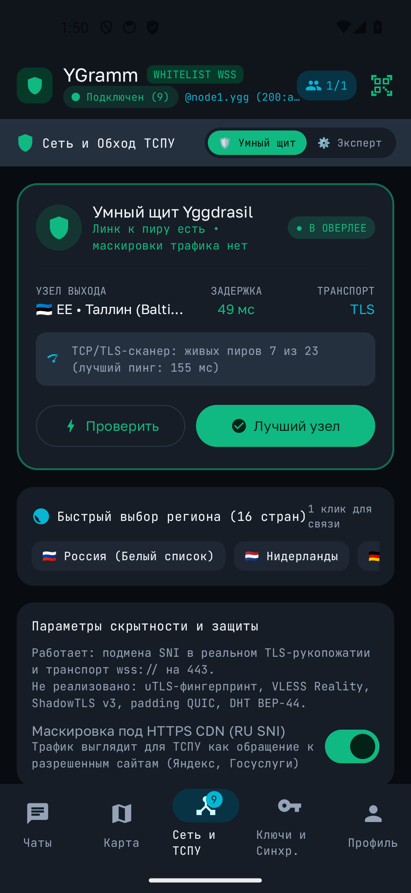
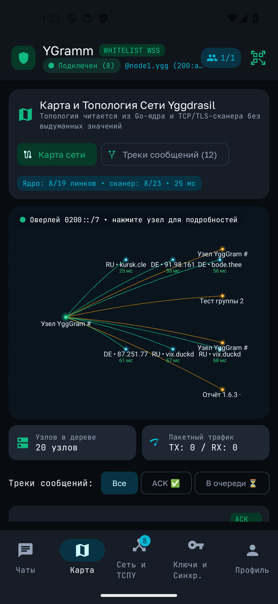
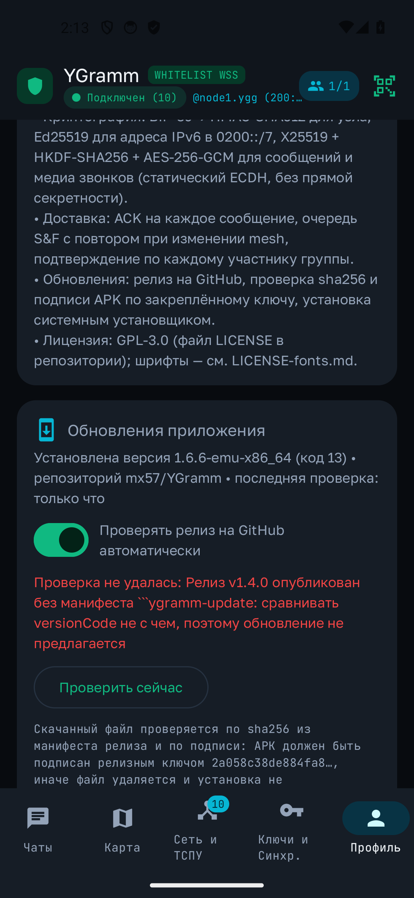

# YGramm

**P2P-мессенджер поверх оверлея Yggdrasil для Android. Без серверов, без телефона, без e-mail — узел находит узел по адресу IPv6 в сети `0200::/7`.**

[](https://github.com/mx57/YGramm/actions/workflows/build-apks.yml)
[](https://github.com/mx57/YGramm/releases/latest)
[](LICENSE)
[](app/src/main/AndroidManifest.xml)

Приложение не подключается к чужому серверу и не знает, кто такой «админ». Каждый экземпляр — это
полноценный узел Yggdrasil: он слушает свой порт, сам обходит NAT-подобные ограничения за счёт
исходящих соединений к пирам и сам шифрует трафик. Сообщение уходит собеседнику напрямую, а не
через нас.

---

## Скриншоты

| Список чатов | Личный диалог с ACK | Групповой чат |
|---|---|---|
|  |  |  |

| Сеть и обход ТСПУ | Карта оверлея | Автообновления |
|---|---|---|
|  |  |  |

Снимки сделаны на отладочной сборке `1.6.6-emu-x86_64` в эмуляторе Android 14. Адреса и имена узлов
на них — тестовые ноды разработчика.

---

## Как это устроено

```
┌──────────────────────────────────────────────────────────┐
│  UI: Jetpack Compose (чаты, группы, карта, профиль)      │
│  ViewModel + Room/SQLCipher (сообщения, пиры, профили)   │
├──────────────────────────────────────────────────────────┤
│  Kotlin-мост YggTwinP2PBridge: handshake-пробы, сокеты,  │
│  транспорт, ACK, очередь send-and-forward                │
├──────────────────────────────────────────────────────────┤
│  libygggram.so — Go-сборка yggdrasil-go v0.5.14          │
│  (LINKS/ironwood) через JNI, несколько профилей сразу    │
├──────────────────────────────────────────────────────────┤
│  Обычные сокеты приложения: tcp:// tls:// wss:// quic:// │
│  Никакого root, системного VPN, TUN или VpnService       │
└──────────────────────────────────────────────────────────┘
```

**Ключевое решение:** ядро поднимается в userspace внутри процесса приложения. Системный туннель
не создаётся, поэтому YGramm работает бок о бок с любой корпоративной или операторской VPN-настройкой
и не требует прав, которых у приложения нет. Плата за это — трафик идёт через сокет приложения, а
не через сетевой стек устройства, и каждый узел должен сам поддерживать соединение с пирами.

### Идентичность узла

| Шаг | Что происходит |
|---|---|
| 1 | Мнемоника BIP-39 (24 слова) — единственное, что нужно запомнить для восстановления узла |
| 2 | `HMAC-SHA512` из мнемоники даёт детерминированный сид Ed25519 |
| 3 | Публичный ключ Ed25519 хэшируется в адрес IPv6 внутри `0200::/7` — это и есть «номер телефона» |
| 4 | Визитка `ygggram://<ipv6>?pub=<hex>&name=…` передаётся по QR, ссылкой или текстом |

Адрес узла — производная от его открытого ключа. Подделать «чужой адрес» нельзя: пакет с таким
адресом пройдёт только у того, у кого есть соответствующий закрытый ключ.

### Шифрование

Два независимых слоя. Ни один из них не зависит от того, что противник видит в интернете.

| Слой | Что шифруется | Алгоритм | Ключи |
|---|---|---|---|
| Транспорт Yggdrasil | Каждый кадр, уходящий в оверлей | `X25519` + `XSalsa20-Poly1305` (Arceliar/ironwood, `nacl box`) | Публичные ключи узлов — участников туннеля |
| Конверт приложения | Текст сообщения **и вложения (фото, файлы, голосовые)** до передачи в ядро | `X25519` ECDH + `HKDF-SHA256` + `AES-256-GCM`. Версия `v3` сворачивает в ключ ещё и одноразовую пару `X25519` на каждое сообщение | Ключ `X25519` из визитки собеседника (`xpub=`); в `v3` — он же плюс эфемерный ключ кадра (`es`) |
| Медиа звонка | Каждый 40-мс PCM-кадр | `AES-256-GCM`, AAD = `ygggram-call:<callId>:<seq>` | Ключ звонка, согласуемый по X25519 при установке вызова |

Проверка кодом: `voice payload crosses the socket only as an envelope the peer key opens`
(`app/src/test/java/com/example/`) поднимает два настоящих узла на `127.0.0.1`, отправляет голосовой
WAV через сокет и проверяет, что в принятом на другой стороне пакете нет открытого base64-WAV
(заголовка `UklGR`), а получатель восстанавливает файл побайтово; `callMediaFrame_isBoundToItsSequenceNumber`
подтверждает, что кадр звонка переживает только свой `seq` и свой `callId`. Профиль проверяется так
же: `editing the profile sends it to a peer and the peer stores it` гоняет кадр `PROFILE` между двумя
узлами на `127.0.0.1` и ждёт `ACK` этого кадра, а `an unsealed profile frame changes nothing` и
`a profile frame from a key that does not match its address is dropped` доказывают, что непрошедшая
проверка не трогает ни имя, ни статус, ни аватар в базе. Присутствие проверяет
`YggPresenceHonestyTest`: отметку «выходил на связь» ставит только открывшийся кадр, а проверка
маршрута, неоткрытый кадр и сообщение в группу её не двигают. Переговоры версии конверта проверяет
`YggEnvelopeV3Test`: в `v3` каждое сообщение получает свой эфемерный `X25519`, подмена `es` в
готовом кадре ломает тег GCM, независимый читатель из `HKDF` и `javax.crypto` восстанавливает текст
без кода приложения, а флаг «пир умеет v3» ставится только из открывшегося `v3`-кадра или из `ACK`,
назвавшего тройку — `ACK` одиночной двойки, чужой кадр и кадр из группы его не ставят.

* Ключи узла: `Ed25519` (подпись и адресация), `X25519` (шифрование) — обе пары детерминированы из мнемоники.
* **Номера сообщений, имена файлов и размер вложения** остаются открытыми: GCM-конверт упакован в
  JSON-кадр, длина и структура которого не скрываются.
* **Отказ вместо слабой маски:** если у чата нет валидного `xpub` собеседника, приложение
  **не отправляет** ни текст, ни вложение, ни голосовое и честно сообщает причину. Открытый
  base64 на канале — это баг, а не режим работы; он убран и из повторной отправки, и из очереди.
  Конверты версии 1 — ключ для которых выводился из общедоступных значений — принимающая сторона
  отвергает с `SecurityException`.
* **Группы:** сообщение шифруется отдельно под ключ каждого участника. Участнику без `xpub`
  сообщение не отправляется, а число таких участников видно в сводке маршрута.
* **Профиль (кадр `PROFILE`):** тело — имя, `@handle`, статус и хэш аватара — едет тем же
  конвертом, что и сообщение. Это единственная причина, по которой чужой узел не может переименовать
  себя в вашем списке: не запечатанное тело не принимается вообще, а запечатанное открывается только
  ключом из визитки отправителя. Отметка времени в теле монотонна (`max(now, предыдущая + 1)`),
  поэтому запаздывающий или повторенный кадр не откатывает профиль к старому состоянию.
* **Совместимость:** вложения, голосовые и звук звонка, отправленные этой версией, не прочитает
  узел 1.6.7 и старше — раньше они шли открытым base64. От того же узла это версия примет.
  Текстовые 1:1 конверты совместны в обе стороны. Кадр `PROFILE` понимают только узлы 1.7.6 и
  новее: старый узел его не применит, и отправитель увидит «не подтвердили», а не «обновлено».
  Конверт `v3` отправляется только тому, кто сам назвал его в `ACK`, поэтому узел 1.7.5 и старше
  продолжает получать `v2` и не теряет ни одного сообщения; читает эта сборка обе версии.
* **Честно:** ключ `v2` выводится из одного статического ECDH, и так было в сборках до 1.7.6 —
  этот конверт открывается закрытым ключом узла, поэтому архив записанных `v2`-кадров
  расшифровывается, если ключ узла скомпрометирован. `v3` добавляет к тому же DH закрытую
  половину одноразовой пары, которая существует только во время вызова шифрования и никуда не
  пишется: записанный `v3`-кадр позже не откроет никто, включая собеседника с выгруженным
  долгосрочным ключом. Прямая секретность появляется у сообщений, отправленных после
  подтверждения `v3`, а не «история чата целиком»: `v2` читается всегда, чтобы смешанный парк
  не терял сообщения, и этот транспорт не переписывает уже отправленные кадры. Ограничение
  протокола Yggdrasil (сеансовый ключ узла — тоже статический ECDH) этим не отменяется.
* **Zhelezyaka** (вариант протокола, устойчивый к активному MITM со стороны промежуточного узла)
  не реализована; при активном атакующем на маршруте возможно downgrade.
* **Подмена ключа собеседника.** X25519-ключ из визитки привязан к адресу узла; для звонка
  дополнительно показывается 4 эмодзи-кода, совпадающих на обоих устройствах только при одном
  и том же общем секрете. Коды нужно сверить вслух при первом звонке.
* **Уведомления.** Текст сообщения, имя отправителя и название файла в уведомлении скрыты по
  умолчанию: видно только тип («Новое сообщение», «🎙️ Голосовое», «🖼️ Фото», «📎 Файл»).
  Переключатель — в настройках приватности, значение сохраняется между запусками.
* **Прямой LAN-обмен** включается пользователем. Пока он выключен, входящее TCP-соединение
  с не-loopback адреса отклоняется: доставка идёт только через оверлей.

### Доставка сообщений

* На каждое принятое сообщение собеседник шлёт `ACK`; в чате он показан как «Доставлено».
* Нет маршрута — сообщение не «отправлено», а честно висит в очереди **Send & Forward**.
* Очередь сбрасывается не только по таймеру (от 45 с до 15 мин: пауза растёт, пока из очереди
  не ушло ни одного сообщения), но и при росте mesh — новый узел в routing tree или
  сразу +3 линка с рукопожатием. Как только маршрут появился, ждущее сообщение уходит сразу.
* В группе `ACK` считается по каждому участнику: «подтвердили 2 из 3» — это реальное число,
  а не обещание. Опоздавший `ACK` тоже засчитывается тому участнику, который его прислал, а
  не теряется: счётчик больше не замирает на том, что успел собрать синхронный проход.
* Повтор рамки не превращается во второе сообщение. Быстрый набор id в памяти моста живёт
  десять минут и гибнет вместе с процессом, поэтому получатель перед вставкой сверяется с
  базой: рамка с уже известным wire-id в этот чат уже попадала.
* Вложенные файлы передаются чанками по 18 000 символов, окном из 4 чанков и таймаутом
  подтверждения 6 с с повтором. Без подтверждения всех чанков файл не помечается доставленным.
* Основной TCP-сокет приёма сам привязывается заново: раньше закрытый сокет означал, что узел
  числится онлайн, но по TCP не отвечает никому до перезапуска приложения.
* Вложение больше 4 МБ не отправляется: приложение пишет причину и не отдаёт собеседнику
  обрезанный файл, который тот не смог бы открыть. Порог один для отправки и для повтора.
* Очередь S&F уходит по росту mesh только если в приватности включён соответствующий
  переключатель; выключенный — остаётся только таймер (от 45 с до 15 мин).

### Звонки

* `RINGING` считается доставленным только после `CALL_ACK` от приложения собеседника, а не от
  операционной системы или транзитного узла.
* Если приложение собеседника не может поднять трубку (профиль не активен в фоне, из мнемоники
  профиля не выводится ключ, узел без профилей), оно отвечает `DECLINE` с причиной. Раньше такой
  вызов молча пропадал, а звонящий продолжал видеть «ожидание ответа».
* Голос в звонке идёт PCM 256 кбит/с, а не Opus: канал шифруется тем же E2EE-ключом, но по
  объёму трафика это дорого. Для белых списков и слабых каналов это будущая работа.

### Что в интерфейсе сознательно не обещается

* **Hashcash PoW** считается на отправке (реальные переборы SHA-256), но на приёме не
  проверяется ни в одной сборке этого репозитория. Лог и текст в UI это прямо говорят.
* **Синхронизация устройств** — это LAN-маяк обнаружения плюс локальный счётчик `StateVector`.
  История сообщений между вашими устройствами по оверлею не передаётся.
* **Восстановление из архива** не реализовано: экспорт пишет на диск сам файл SQLCipher и сверяет
  его Merkle root, но обратного пути нет — нельзя закрыть открытую базу, подменить файл и
  продолжить работу в том же процессе. Кнопка «Восстановить» говорит об этом прямо.
* **Шаг ратчета** (`step`) едет в конверте `v2`, но не входит ни в ключ HKDF, ни в AAD, а в `v3`
  его нет вовсе. Реальное свойство — E2EE на конверт с epoch, плюс одноразовый ключ сообщения в
  `v3`: это не ратчет Signal, здесь нет цепочки ключей, предзаписанных PreKey-ов и «одного
  взлома — одного ключа». И своя копия сообщения лежит в базе открытым текстом: прямая
  секретность относится к записанному на проводе, а не к телефону, который изъяли вместе с
  базой.
* **Справочника профилей нет.** Имя, `@handle`, статус и аватар отправляются тем, кому вы пишете,
  и большему ничему: поиска узла по адресу, ленты или «профиля в сети» не существует, и
  «отправлен всем» в этом транспорте было бы обещанием без покрытия. Диалог, в который вы не
  писали, профиля не получит — кадр от узла без диалога отклоняется.
* **Статуса «в сети» нет.** Оверлей отвечает за узел, а не за человека: TCP-порт открыт и когда
  телефон лежит в кармане. Единственное, что приложение знает достоверно, — время последнего
  открывшегося кадра от собеседника, и именно его оно и пишет. Никаких «был(а) недавно»,
  «в сети» или зелёного присутствия из проверки маршрута здесь не делается.

### Обход блокировок: что реально работает

| Работает | Детали |
|---|---|
| Транспорт `tls://` | Без маски рукопожатие делает Go-стек ядра: `ClientHello` с SNI, но без ALPN. С включённой маской его делает TLS-стек телефона — см. следующую строку |
| Маска TLS со стека телефона | Ядро подключается к 127.0.0.1, а рукопожатие с настоящим пиром выполняет Conscrypt: `ALPN h2, http/1.1` (ALPN — с Android 10, ниже его нет в публичном API), TLS 1.3, выбранный SNI. Связь выглядит как обычный HTTPS с устройства, а не как Go-клиент без ALPN. Байты кадров прокси не читает и не меняет |
| Открытые `tcp://`-пиры в режиме белых списков | Тот же узел пробуется как TLS на 443, потому что нестандартный порт белый список не пропускает. Пока режим включён, исходный открытый диал не набирается: повторять рукопожатие на порт, который провайдер гарантированно роняет, — это ровно тот трафик, ради отключения режим и включается |
| Подмена SNI | Для пиров с доменным именем в базе ядро ставит выбранный домен в `ClientHello` — цензор видит обращение к разрешённому сайту |
| Смена SNI на живой ноде | Выбор домена не ждёт перезапуска: ссылка снимается и ставится заново с новым `ClientHello`. Пир, который пользователь сам выключил, этим не включается |
| Автопилот при отказе ссылок | Если ядро держит меньше двух линков с рукопожатием, приложение опрашивает `publicnodes` и добавляет проверенный резерв — одним внутренним каталогом оно не ограничивается. Не чаще одного раза в 5 минут, а если сеть измерена как фильтрующая адреса или молчащая — не чаще одного раза в 30 минут: на такой связи резервные узлы всё равно недоступны, и гонять каталог каждые 30 с означает тратить мобильный трафик впустую. Если измерение показало, что по связи нет выхода в интернет, автопилот узел не ищет вовсе — опрос каталога, пробы кандидатов и диал ушли бы по маршруту, который не несёт ничего, — и говорит об этом отдельной строкой с причиной вместо молчаливого обещания. Если ни один кандидат не подошёл, причина тоже называется вслух |
| Транспорт `wss://` | Кадры Yggdrasil инкапсулируются в WebSocket поверх HTTPS, порт 443 |
| Транспорт `quic://` | UDP-соединения к пирам, поддерживающим QUIC |
| Честная проба пиров | Пир считается живым только после ответа на рукопожатие Yggdrasil. Открытого порта мало — иначе список пиров забивается «мёртвыми» адресами |
| Измерение белого списка сети | Кнопка «Что пропускает моя сеть: проверить адреса» на экране сети: восемь контрольных TCP-соединений к адресам, не связанным с приложением (домены и «голые» IP, разнесённые по разным хостерам), и вердикт по картине ответов. Часть адресов проходит, часть отклоняется — сеть выбирает по адресу назначения; имена не разрешаются, а IP отвечают — фильтруется DNS; отвечают все — сеть открыта. Отказ и молчание — разные наблюдения: если ни один адрес не отклонён, но все не ответили за 1500 мс, вердикт «сеть молча дропает соединения», и он не выдаётся за белый список, потому что по молчанию нельзя отличить дроп от отсутствующего маршрута; если хоть один адрес получил явный отказ при нуле ответов — «нет выхода в интернет» с разбивкой по механизмам (сколько отклонено, сколько молчит, сколько имён не разрешилось). Замеренные состояния одной и той же связи: проходит 3 адреса из 8, из 28 публичных пиров каталога на 443 не проходит ни одного, отказ приходит как `ECONNREFUSED` через 62–102 мс ещё до TLS; в другой момент на том же телефоне DNS отвечал, а все восемь адресов молчали до таймаута (самопроверка в приложении). Измеритель различает и стадию отказа: на фильтрованной связи она приходит при установлении соединения, то есть в сеть не уходит ни байт ClientHello и маскировать там нечего — SNI, ALPN, `wss://` и `quic://` ничего не меняют, потому что решение принимается по адресу, а не по содержимому. Если бы соединения устанавливались и рвались после первых байт, вердикт сказал бы про это отдельно: там маска — осмысленный вопрос. Под вердиктом стоит время замера («Измерено в 12:40 • 5 мин назад»), которое обновляется само, пока экран открыт: час назад вердикт относился к другой связи |
| Честный счётчик линков | «Живых линков» в экране сети — это пиры, на которых ядро увидело открытый ключ собеседника, то есть рукопожатие оверлея действительно завершилось. Go-ядро поднимает флаг `Up` уже в момент открытия сокета, поэтому 14 соединений с портами, которые не отвечают по протоколу Yggdrasil, раньше выглядели как 14 линков; теперь такие сокеты показаны отдельно — «соединений без рукопожатия». Бейджи «В СЕТИ», «● В ОВЕРЛЕЕ», счётчик в уведомлении и в карточках пиров считаются по подтверждённым линкам |
| Самопроверка маски | Кнопка «Проверить маску на моих пирах» на экране сети: TLS-рукопожатие со стека телефона к каждому сохранённому пиру, по строке результата на пира — принятый `ClientHello` с названием домена и negotiated шифр против конкретной причины отказа (`TLSV1_ALERT_INTERNAL_ERROR`, `ECONNREFUSED`, таймаут). Это проверка рукопожатия, а не доставки: сообщение по замаскированному пути она не подтверждает |
| Узел принимает входящие | Ядро вызывает `Listen` на `tcp://0.0.0.0:5985` и `tls://0.0.0.0:443`: узел не только сам кого-то набирает, но и отвечает входящим соединением по протоколу Yggdrasil, поэтому его может добавить к себе другой узел. `ss -tln` на устройстве показывает `*:5985` за процессом приложения, а входящий диал получает приветствие `meta.u` с открытым ключом этого узла. Порт 443 без root приложению не отдать, и отказ слушателя попадает в журнал ядра |
| TCP/TLS-сканер каталога | Проверка задержки и живости публичных пиров в 16 странах |

| **Не реализовано** | Статус |
|---|---|
| uTLS (подмена фингерпринта ClientHello) | ClientHello собирает системный TLS-стек; выбор «профиля uTLS» сохраняется в базе пиров, но на трафик не влияет |
| VLESS Reality, ShadowTLS v3 | В сборке нет ни того, ни другого |
| Выравнивание длины QUIC-датаграмм (padding) | Не делается |
| Bootstrap через BitTorrent DHT (BEP-44) и DoH | Не делается; списки пиров берутся из встроенного каталога и из ручного добавления |
| Обход фильтра по адресу назначения | Не решается транспортными масками и не решается в приложении: если сеть пропускает только адреса из своего списка, узел должен стоять по адресу из этого списка (или нужен выход в другую сеть). Приложение это измеряет и честно сообщает, а не обещает обход |
| gVisor / netstack / системный TUN | Не используются и не планируются: см. «userspace-ядро» выше |

Интерфейс не предлагает переключатели для несуществующих функций: то, чего сборка не умеет,
в ней помечено как «НЕТ В СБОРКЕ».

### Функции

* Пять тем оформления: тёмные «Кибер-изумруд», «Полночное индиго», «Терракота» и светлые «Снежная»,
  «Графит». Выбор в настройках профиля, применяется сразу и переживает перезапуск; системный
  режим светлой/тёмной темы не отслеживается — узел сам выбирает палитру.
* Личные чаты, группы с добавлением контактов, отображение имени контакта в списке, в шапке и в групповом чате.
* Управление группой с экрана чата: переименование, исключение участника из состава, выход из группы
  (с двойным подтверждением и честным предупреждением, что удалится только с этого устройства).
* Ответ на сообщение жестом: пузырь сдвигается пальцем в сторону, при перевале порога открывается
  цитата-ответ. Порог 90 dp считается в пикселях по плотности экрана, а не по ширине окна.
* Реакции: быстрый ряд из 8 пилюль и выпадающий список всех ~60 эмодзи по категориям. В группе
  реакция расходится каждому участнику, и счёт «N из M подтвердили» строится по реальным `ACK`.
* Токен реакции с сети нормализуется перед записью: разделители `:` и `|`, NUL и управляющие
  символы вырезаются, длина ограничена, так что чужой текст не может разбить одну реакцию на две
  строки или оставить несовпадающий ключ.
* Профиль по сети: имя, `@handle`, статус и аватар уходят только тем, кому вы уже пишете, и каждому
  запечатываются его собственным ключом. Кадр без отметки времени или без запечатанного тела
  отбрасывается, кадр старше сохранённого ничего не перетирает, а ключ, не совпадающий с заявленным
  адресом узла, не записывает ничего. Диалог под профиль создаётся только существующий: профиль от
  незнакомца не превращает список чатов в почтовый ящик имён.
* Аватары: генерируются на устройстве и передаются по оверлею. Байты картинки идут рядом с кадром,
  но её SHA-256 лежит внутри запечатанного тела — получатель сохраняет только то, что совпало с
  хэшем из тела, открывшегося его ключом, и не пишет на диск кадр, который не является картинкой.
  Профиль без аватара с более новой отметкой аватар у собеседника стирает: удалённая картинка не
  должна жить там, где её уже убрали.
* Обложка группы: её ставит любой участник (у группы нет владельца, кто бы это запрещал), и она едет
  на тех же кадровых рамках, что и состав, — отдельного канала под картинку не открывается. Хэш
  обложки и её байты расходятся по отдельным полям рамки, поэтому получатель пишет на диск только
  то, что совпало с заявленным хэшем и декодируется в картинку. Лицо написавшего участника при этом
  уходит в его личный диалог, а не в группу: иначе первое же селфи заменило бы обложку.
* Аватар в уведомлении: `largeIcon` строится по файлу этого диалога на этом устройстве. Своей
  картинке у уведомления нет — если файл аватара ещё не пришёл или уже удалён, уведомление
  выходит без иконки, а не с похожей из кэша. В групповом чате иконкой становится обложка группы,
  потому что это картинка диалога, а не написавшего: лицо автора рамка в группу не приносит.
* Присутствие — это отметка «выходил на связь», а не «в сети». Ставит её только кадр, который
  открылся под ключом этого устройства: сообщение или профиль. Проверка маршрута до порта узла
  ничего про человека не говорит, поэтому отметку не трогает; неоткрытый кадр, группа (там кадр
  доказывает, что написал кто-то, а не кто именно) и собственный эхо-кадр её тоже не двигают.
  В шапке чата — «Выходил на связь: 14:32», если кадр был, и «Выход на связь не зафиксирован»,
  если отметки ещё нет; в списке диалогов точка цвета транспорта означает подтверждённый маршрут.
* Голосовые сообщения: захват `AudioRecord` 16 кГц / 16-bit mono PCM, воспроизведение `AudioTrack`, реальный рингбэк. При отправке запись сжимается системным кодеком Opus (`MediaCodec`, 24 кбит/с, кадры по 20 мс) в контейнере `YGO1` — но только собеседнику, который сам назвал `opus` в подтверждении доставки; остальным уходит обычный WAV. Кадр `ACK` и маркер `voiceCodec` на проводе — обе отметки ставит только сборка 1.7.6 и новее, поэтому старый клиент сжатого голоса не увидит. В экране «Обход ТСПУ» есть кнопка замера кодека на этом телефоне: она показывает, какой кодер реально найден, сколько байт ушло и вернулся ли тон после декодирования.
* Большие файлы идут кусками по 12 КиБ (`FILE_PIECE_BYTES`): у каждого куска свой контейнер
  AES-256-GCM со своим AAD, а в конце сверяется корень Меркла из SHA-256 кусков. Получатель
  отвечает накопленным `haveThrough`, поэтому оборванный линк не начинает сначала — досылаются
  куски с подтверждённой границы. До 4 МиБ вложение по-прежнему едет одним сообщением, потолок
  потока — 512 МиБ (`MAX_P2P_STREAM_BYTES`). Файл берётся только через системный выбор (SAF /
  Photo Picker): имя и размер читаются у провайдера, а не выдумываются.
* Отзыв своего сообщения («Удалить у всех»): рамка `MSG_DELETE` несёт доказательство авторства —
  подпись под идентификатором сообщения, которая открывается ключом из визитки. Собеседник стирает
  свою копию только после проверки, иначе запрос отклоняется с уведомлением. Стирание подтверждается
  `ACK` адресата, а дубликат ретрая отправителя не удаляет повторно.
* Очистка чата: «Очистить» стирает сообщения диалога, их файлы на диске, журнал передач и
  tombstone-удаления, оставляя сам контакт.
* «Хранилище устройства» в профиле считает байты по самим файлам (вложения, голосовые, аватары,
  база, кэш, загруженное обновление), а не по счётчикам в базе; «Убрать осиротевшие файлы» добирает
  то, на что не ссылается ни одно сообщение.
* Несколько профилей-узлов одновременно: у каждого свой ключ, свой порт слушателя и своя таблица пиров.
* «Избранное» — заметки самому себе на собственном узле.
* Карта и топология: дерево узлов читается из Go-ядра, задержки — из реальных проб, выдуманных значений нет.
* Треки сообщений: видно, что ушло, что подтверждено, а что ждёт в очереди.
* Приватность: блокировка скриншотов и записи экрана (`FLAG_SECURE`), автоудаление по TTL, скрытие текста в уведомлениях, экстренное стирание всех ключей и истории (panic-wipe).
* Автообновления через релиз на GitHub (см. ниже).
* Тот же APK можно попросить у собеседника в оверлее, когда GitHub недоступен: пир переносит
  байты потоком файлов, а решает приём — только это устройство по своему сохранённому манифесту
  и по релизному ключу подписи.

---

## Автообновления

Приложение проверяет **последний релиз этого репозитория на GitHub** и предлагает установку через
системный установщик Android. Ничего не устанавливается молча.

1. При запуске (и по кнопке «Проверить») запрашивается `https://api.github.com/repos/mx57/YGramm/releases/latest`.
2. В теле релиза ищется машиночитаемый JSON-блок в fences ` ```ygramm-update `:

   ```ygramm-update
   {"versionCode": 15, "versionName": "1.6.8-arm64-v8a", "apk": "YGramm-arm64-v8a.apk", "sha256": "<64 hex>"}
   ```

   Поля строго `versionCode` (целое &gt; 0), `versionName`, `apk` (имя файла в релизе) и `sha256`
   (64 hex-символа). Нет блока или хоть одно поле не заполнено — приложение честно пишет
   «Релиз опубликован без манифеста» и **не** предлагает обновление: сравнивать `versionCode`
   не с чем, и брать его из имени тега оно не вправе.
3. Если `versionCode` в релизе больше установленного — показывается версия, номер сборки и текст релиза.
4. Скачивание идёт в приватный каталог приложения с прогрессом; по окончании проверяются **две** вещи:
   * `sha256` файла совпадает с манифестом;
   * APK подписан сертификатом с дайджестом `2a058c38de884fa8df2751226100a5d780fb20c28465b52d9d7bd238ff9d0f9c` —
     тем же ключом, что и установленное приложение.
   Не совпало — файл удаляется, обновление не предлагается.
5. Дальше приложение просит разрешение «Установка из неизвестных источников» (если оно не выдано —
   открывает нужный экран настроек) и передаёт файл системному установщику через `FileProvider`.

Зачем и `sha256`, и подпись: хэш в релизе публикует тот же автор, что и сам релиз, то есть сам по
себе доверия не даёт. Решающая проверка — сертификат: Android-установщик в любом случае откажется
ставить APK поверх установленного, если он подписан другим ключом. Репозиторий может быть публичным,
а подменить сборку без приватного ключа подписи нельзя.

### APK через знакомый узел

Если сеть не пропускает GitHub, тот же самый файл можно попросить у собеседника, с которым уже есть
личный диалог по оверлею. Экран «Обновления приложения» для этого содержит переключатель раздачи,
кнопку запроса, поле для вставки манифеста и живую строку прогресса.

1. **Якорь — только свой.** Приложение хранит в `files/update/last_manifest.json` манифест, который
   это устройство увидело само: из ответа GitHub или из блока, вручную вставленного пользователем.
   Ответы пира в этот файл не пишутся. Без якоря запрос не отправляется — спрашивать не с чем.
2. **Раздача выключена по умолчанию.** Включение её переключателем разрешает отдавать файл только
   ноде, с которой у этого профиля есть личный диалог, и только тот APK, чей SHA-256 уже сверен
   этим устройством с манифестом. Всё остальное отклоняется с текстом причины, который видит
   запрашивающая сторона: «раздача выключена», «нет личного диалога», «нет скачанного файла»,
   «файл не читается», «файл не тот».
3. **Запрос изобретает идентификатор здесь.** Поток `APK_RELAY` принимается только под тот
   `transferId`, который это же устройство и заказало: пир не может принести установщик «сам
   собой». Имя временного файла собирается из ограниченного алфавита (`a-zA-Z0-9._-`), а проверенный
   APK ложится под имя из собственного манифеста получателя, а не под то, что прислал пир.
4. **Транспорт общий с вложениями.** Куски по 12 КиБ, у каждого свой AES-256-GCM контейнер,
   накопленный `haveThrough` для дозакачки и корень Меркла по всему файлу — то есть целостность
   переноса доказана до того, как начинается проверка содержимого.
5. **Содержимое решает приём.** Дойдя до конца, получатель сам считает SHA-256 принятого файла и
   сам читает его подпись: не совпало с якорем или с релизным ключом — файл удаляется, установка не
   предлагается. Совпало — появляется та же кнопка «Установить», что и после скачивания с GitHub,
   и установку по-прежнему выполняет системный установщик Android.

Перенос байтов чужим устройством не добавляет доверия к содержимому: он экономит только трафик до
GitHub. Подделать сборку по этому пути нельзя — подпись проверяется по локально зашитому дайджесту
релизного сертификата.

---

## Установка

Готовый APK публикуется в [Releases](https://github.com/mx57/YGramm/releases/latest):

```
YGramm-arm64-v8a.apk        # подписанный релиз, только arm64-v8a
YGramm-arm64-v8a.apk.sha256  # контрольная сумма
```

Проверить скачанный файл:

```bash
sha256sum -c YGramm-arm64-v8a.apk.sha256
```

**Требования:** Android 7.0 (API 24) и выше, процессор `arm64-v8a`. Смартфоны на x86_64
и эмуляторы этой архитектуры не поддерживаются — под них собирается отдельная отладочная сборка
(см. «Сборка»).

---

## Сборка из исходников

Нужен JDK 21, Android SDK (compileSdk 36.1), Go 1.25 и Android NDK.

**1.Native-ядро.** `libygggram.so` намеренно не лежит в git — бинарники в истории только раздувают
репозиторий. Без этого шага APK соберётся, но при запуске покажет «НЕТ ЯДРА».

```bash
cd core
CGO_ENABLED=1 GOOS=android GOARCH=arm64 \
  CC="$ANDROID_NDK_HOME/toolchains/llvm/prebuilt/linux-x86_64/bin/aarch64-linux-android24-clang" \
  go build -buildmode=c-shared -o ../app/src/main/jniLibs/arm64-v8a/libygggram.so ./cmd/libygggram
```

**2. Тесты.**

```bash
./gradlew :app:testDebugUnitTest
```

**3. Отладочный APK** (подписывается debug-ключом, ставится сразу):

```bash
./gradlew :app:assembleDebug
# -PemuX86 добавляет x86_64 — только для эмуляторов, релиз с таким флагом не публикуется
```

**4. Релизный APK.** Ключ подписи держится вне репозитория; в CI релиз собирается, но не подписывается,
потому что upload-ключа у раннера нет.

```bash
export KEYSTORE_PATH=… KEYSTORE_PASSWORD=… KEY_ALIAS=… KEY_PASSWORD=…
./gradlew :app:assembleRelease :app:exportSingleArm64ReleaseApk
```

Проверить, что APK подписан релизным ключом:

```bash
$ANDROID_HOME/build-tools/36.0.0/apksigner verify --print-certs YGramm-arm64-v8a.apk
# SHA-256 digest of signer: 2a058c38de884fa8df2751226100a5d780fb20c28465b52d9d7bd238ff9d0f9c
```

---

## Тесты и CI

GitHub Actions ([`.github/workflows/build-apks.yml`](.github/workflows/build-apks.yml)) на каждом push
и pull request:

1. собирает `libygggram.so` NDK-ом за указанной выше команде;
2. гоняет **всю** юнит-тестовую сюиту, включая Robolectric-тесты доставки, проб пиров и чистого старта;
3. собирает debug- и release-вариант (то есть R8, shrinking и merge манифеста проверяются всегда);
4. **отказывается** публиковать артефакт, если внутри APK нет `lib/arm64-v8a/libygggram.so`.

Что покрывают тесты, помимо логики: разбор манифеста обновления, отказ предлагать обновление без
манифеста, сравнение `versionCode`, очистку текста релиза от машиночитаемого блока и контрольную
сумму fixture-файла. Отдельно — сквозная проверка конвертов: голосовое сообщение, ушедшее через
реальный сокет между двумя узлами, приходит без открытого base64 и восстанавливается у получателя
побайтово, а кадр звонка принимается только со своим `seq` и своим `callId`.

---

## Известные ограничения

* Только `arm64-v8a` в релизе; x86_64 существует лишь как отладочная сборка для эмуляторов.
* Прямая секретность — только у конверта `v3`, только для сообщений, отправленных после того как
  собеседник подтвердил `v3` в `ACK`, и только против записи трафика: свои сообщения приложение
  хранит открытым текстом в базе. Кадры `v2` (а значит и вся переписка до 1.7.6) по-прежнему
  открываются долгосрочным ключом узла — см. «Шифрование».
* Голос в звонке — несжатый PCM 16 кГц (256 кбит/с): трафик звонка заметно тяжелее, чем Opus.
  Сжатие появилось только в голосовых записях; для звонка нужен отдельный пересчёт кадра на
  20 мс и согласование кодека в сигнализации вызова — это не сделано. В групповых записях
  сжатия тоже нет: один payload уходит всем участникам, а доказательство кодека есть у каждого
  собеседника отдельно.
* Совместимость версий: 1.6.6 и 1.6.7 отправляют голосовые и вложения открытым base64 — 1.6.8 их
  не примет; вложения и звук звонка из 1.6.8 не примет 1.6.7 и старше. Текстовые 1:1 конверты
  совместны во все стороны.
* Текст уведомления виден, пока в настройках приватности включён «Показывать текст» — по умолчанию
  выключено.
* При выключенном LAN (`transport.lan_enabled`) транспортный `PeerListener` биндится на `::1`
  вместо `::` и дополнительно отклоняет не-loopback соединения на входе, поэтому удалённый узел не
  может подключиться напрямую. Оверлейный mesh-маршрут (через пиры ygg-link) это не отключает.
* Экран «Ключи и Синхр.» выгружает **файл шифрованной базы**: байты копируются в выбранный
  документ, а размер, число кусков по 12 КИБ и Merkle root берутся из прочитанного обратно
  архива — не из числа строк в таблицах. Параметры шифра экран печатает те, что отвечает сам
  SQLCipher через `PRAGMA cipher_version`/`PRAGMA cipher`. Argon2id, XChaCha20-Poly1305, Zstd и
  FastCDC в этом пути не участвуют; загрузка на WebDAV не делается. Ключ к архиву обёрнут
  Keystore этого устройства, поэтому скопированный файл без него не открыть.
  Восстанавливать профиль пока умеет только мнемоника BIP-39.
* Переключатель «Удаление EXIF и сетевых метаданных» ничего не вырезает — `ExifInterface` в сборке отсутствует.
* Режим белых списков ограничивает список обзвона, а не само соединение: при нём ядро набирает
  только `wss://` и эндпоинты на 443, а каждого `tcp://`-пира вне 443 переводит на маску (TLS на 443
  со стека телефона) и снимает его открытый диал — повторять рукопожатие на порт, который провайдер
  гарантированно роняет, режиму незачем. Пир, который нельзя выразить через 443 (`tls://host:7743`),
  с обзвона снимается целиком; запись о пире при этом не удаляется, выключение режима возвращает все
  диалы. Пересчёт списка идёт по самому списку обзвона работающей ноды, а не по флагу «пир отвечает»
  в базе: на телефоне пользователя с белыми списками ни одна TCP-проба пиров не отвечает, и проход по этому
  флагу не снимал и не возвращал ни одного диала. Замер на нём же (сборка 1.7.5): выключение режима
  подняло список ядра с 27 диалов до 38, обратное переключение вернуло его к 13 — без перезапуска
  приложения. Единственная уступка: если локальный эндпоинт маски не поднялся, узел снова набирает
  исходный диал — ссылка с шансом лучше, чем пустой список обзвона. Самопроверка маски показывает,
  какие из пиров такой рукопожатием действительно принимаются.
* Входящий `tls://0.0.0.0:443` на Android не поднимается: привилегированный порт без root приложению
  не отдать. Работает входящий `tcp://0.0.0.0:5985`. Узел за NAT-роутером снаружи всё равно не
  виден, пока его не наберёт узел из той же сети.
* Светлые темы («Снежная», «Графит») перекрашивают интерфейс по токенам палитры, но часть
  элементов (оверлей звонка, карта, всплывающее уведомление, QR-код) намеренно остаются тёмными
  или белыми поверхами — они читаются в любой теме, однако выглядят контрастнее, чем в тёмных.
* Поиск пиров ограничен встроенным каталогом, ручным добавлением и `publicnodes` в проходе автопилота:
  автономного discovery (DHT, DoH) в сборке нет.
* История не синхронизируется между устройствами и не переносится на новое: экспорт пишет
  зашифрованный файл базы в выбранный пользователем документ (SAF) и сверяет его корень Меркла,
  но обратного пути нет — импортировать или восстановить этот архив приложением нельзя. Мнемоника
  BIP-39 возвращает ключи профиля и адрес узла, но не сообщения.
* Приложение не проверяет, что второй узел «настоящий», помимо соответствия адреса открытому ключу:
  подтверждение личности — это ваша ответственность (сравните отпечаток визитки по QR при личной встрече).
* Переименование группы локально: имя меняется на этом устройстве и уезжает в чужой чат только если
  тот ещё не создан. Автоматически принимать чужое имя нельзя — участник со старым именем вернул бы
  его же следующей рамкой, и имя начало бы скакать.
* Обложка группы — последнее выигравшее: у неё нет ни версии, ни подписи автора, потому что сервера
  у группы нет и доказывать авторство кадра некому. Сменить картинку может любой участник, и
  удалить её у остальных нельзя: пустое поле обложки неотличимо от «у этого участника обложки нет»,
  поэтому в диалоге группы намеренно нет кнопки «убрать» — приложение не обещает то, что не может
  отличить от молчания.
* Исключение участника из группы действует на вашей стороне: ваше следующее сообщение в группу до
  него не дойдёт, но остальные члены продолжат слать ему свои — сигнала «ты вышедший» в оверлее нет.
* Выход из группы удаляет чат и её переписку с этого устройства и не уведомляет остальных; состав,
  который они рекламируют, всё равно будет приходить в их рамках.
* «Удалить у всех» стирает копию только у того, кто её получил. Недоставленное (адресат был офлайн)
  стирать нечего, а пересланный текст или скриншот на чужом устройстве удалением не отзываемся:
  оверлей не управляет чужим диском. Пока нет `ACK` адресата, сообщение у него остаётся.
* Кусковый транспорт требует закреплённого ключа X25519 адресата: без него куски нечем проверить,
  и передача честно отказывается. В группе поток заводится на каждого участника отдельно, поэтому
  участник, у которого в визитке нет ключа, файла не получает — приложение об этом говорит в
  баннере, а не делает вид, что доставил.
* Подтверждение есть только на начало потока: если адресат не ответил на `FILE_BEGIN` (маршрут
  пропал, узел ушёл в офлайн), поток считается непереданным, а сообщение остаётся в очереди S&F.
  Куски не копятся «впрок» на стороне получателя без его подтверждения.
* Осиротевшие файлы — это ровно то, на что не ссылается ни одна строка `attachmentUri`. Скачанный
  APK обновления в этот список не попадает и остаётся до установки: иначе «Установить» не найдёт,
  что запускать.
* Осколки незавершённого приёма (`stream_*.part`) кнопка не трогает — поток живёт только внутри
  процесса, и удалить их нельзя, не рискуя оборвать приём. Они стираются при следующем запуске
  моста, когда продолжения у файла уже нет; отправитель при этом начинает поток заново.
* `APKREQ` понимают обе стороны, начиная с 1.7.6: более старый клиент на запрос молчит, и устройство
  честно пишет «собеседник молчит: ответа на запрос нет», а не «обновление не доступно». Делиться
  пир готов только файлом, который уже сошёл у него с контрольной суммой GitHub, — сам запрос ничем
  не дополучает. Этот путь пока проверен юнит-тестами и кодом, но не живой передачей между двумя
  устройствами: на момент сборки mesh был без пиров, и подтвердить перенос байтами по оверлею нечем.

Мы предпочитаем написать «не реализовано», чем показать переключатель для несуществующей функции.
Если в интерфейсе встречается формулировка, которая обещает больше, чем делает код, — это баг,
и мы ждём по нему issue.

---

## Безопасность

Нашли уязвимость — сообщите через приватный доклад об уязвимости в GitHub
(вкладка Security → Report a vulnerability) или issue без деталей эксплуатации. Не публикуйте
подробности до выхода исправления.

---

## Отказ от ответственности

Прочитайте этот раздел до сборки, установки и использования. Он написан простым языком и не
заменяет юридическую консультацию.

**Программа поставляется «как есть», без каких-либо гарантий.** Код распространяется по GPL-3.0:
раздел 15 лицензии отказывает от гарантий коммерческой пригодности и пригодности для конкретной
цели, раздел 16 ограничивает ответственность автора и участников. Программа может не работать,
может потерять переписку, может быть заблокирована сетью или удалена из системы. Автор не даёт
обещаний о надёжности, доступности и безопасности и не обязан что-либо исправлять.

**Автор не оператор сети.** Под этим проектом нет серверов, ретрансляторов, peer-хостов, аккаунтов,
базы переписки и телеметрии: приложение ничего не отправляет автору, а сообщения идут только между
узлами, которые подключены друг к другу. Если вы подключаетесь к публичному пиру из каталога или
находите его через `publicnodes`, вы выбираете это сами, и его оператор видит ваш IP-адрес, время
и объём соединения. Претензии к третьим узлам и к их операторам адресуйте им, а не автору.

**Это не средство анонимности и не «VPN-сервис».** YGramm поднимает один узел оверлейной сети в
userspace-процессе приложения и не уводит весь трафик устройства. Подмена SNI, ALPN и транспорт
`wss://` нужны для совместимости с сетями, которые пропускают только порт 443; они не скрывают
метаданные соединения, не прячут mesh-адрес узла и не делают наблюдателя канала слепым. Прямой
секретности в текущей сборке нет (см. «Известные ограничения»). Считать этот транспорт средством
сокрытия от работодателя, провайдера или государства — ошибка.

**Соответствие закону — ответственность пользователя.** Перед использованием проверьте, разрешено
ли вам в вашей юрисдикции, по договору с провайдером и по правилам сети или работодателя:
устанавливать такое ПО, поднимать узел оверлейной сети, принимать входящие соединения и применять
маскировку транспортного рукопожатия. Автор не выдаёт разрешений, не оценивает законность ваших
действий и не одобряет использование программы там, где она ограничена или запрещена. Если в вашей
стране распространение или использование подобных средств ограничено — не устанавливайте и не
распространяйте сборку, либо предварительно проверьте это с юристом.

**Запрещено незаконное применение.** Программа предназначена для частной переписки. Использование
для трафика, нарушающего закон, — мошенничество, шантаж, угрозы, распространение запрещённого
контента, в том числе материалов с эксплуатацией детей, — не является функцией этого кода и не
получает ничьего одобрения; ответственность за такие действия несёт только тот, кто их совершил.

**Ключи и данные — только ваши.** Утерянная мнемоника BIP-39 невосстановима: ни автор, ни никто
другой не сможет вернуть профиль. Экспорт шифрованной базы в файл есть, но восстановления из
архива и выгрузки переписки в читаемом виде нет, поэтому повреждение базы или устройства означает
потерю истории. Доступ к разблокированному телефону даёт
доступ к чатам — защита экрана и FLAG_SECURE не заменяют пароль на устройстве.

**Шифрование и экспорт.** В программе используется криптография. В ряде стран экспорт, импорт или
распространение шифрующих средств регулируется; прежде чем передавать сборку или её копию за
пределы своей юрисдикции, проверьте контроль экспорта криптографии.

**Товарные знаки и чужие домены.** Yggdrasil и остальные названия принадлежат их правообладателям.
домены, которые можно подставить в SNI в пресетах маски (например `static-mon.yandex.net`), — это
просто строки в рукопожатии клиента: мы не связаны с владельцами этих доменов, их инфраструктура
ничего не обрабатывает и не участвует в соединении, а сам факт использования имени не означает их
согласия или одобрения. Публикуя свою сборку, подбирайте SNI сами и на своё усмотрение.

**Вклад участников.** Отправляя изменений в этот репозиторий, вы подтверждаете, что имеете право
лицензировать его по GPL-3.0, и что ваш вклад тоже поставляется без гарантий.

---

## Лицензия

* Код приложения и ядра — **GPL-3.0** ([LICENSE](LICENSE)).
* Шрифты — отдельные условия, см. [LICENSE-fonts.md](LICENSE-fonts.md).
* Использованы открытые реализации: [yggdrasil-go](https://github.com/yggdrasil-network/yggdrasil-go) v0.5.14
  и [Arceliar/ironwood](https://github.com/Arceliar/ironwood).
